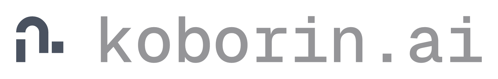

# koborin-ai

`koborin-ai` is a personal org rooted in a way of living: shaping oneself through repeated cycles of *hypothesize → verify → return*. Reading, music, and warm baths keep the loop steady. Spinning the loop together with the people I care about and with AI, life becomes richer.

This repository is the visual identity for `koborin-ai`. It holds the icon, the lockups, the palette, the typography, and the voice.

The mark is an arch, a detached left cursor bar, and a square dot at the baseline on the right. Nozomi adopted it on 2026-10-28. The mark uses the accent color. The favicon and the app icon are the dark tile in every theme.

<!-- brand:hero -->
<picture>
<source media="(prefers-color-scheme: dark)" srcset="lockup/lockup-dark-256.png">

</picture>
<!-- /brand:hero -->

## Palette

<!-- brand:palette -->
| Role | Dark | Light |
| --- | --- | --- |
| bg | `#0b0d12` | `#faf9f6` |
| fg | `#eceae5` | `#16161a` |
| accent | `#d5dae1` | `#4a5260` |
| muted | `#eceae56b` | `#16161a73` |

The mark uses the accent color. The wordmark uses the muted color. The tile uses the dark theme.
<!-- /brand:palette -->

## Typography

<!-- brand:typography -->
| Face | Family | Weights | Stack |
| --- | --- | --- | --- |
| body | Geist | 400 | `Geist, Noto Sans JP, sans-serif` |
| wordmark | Geist Mono | 500 | `Geist Mono, Noto Sans JP, ui-monospace, monospace` |
| japanese | Noto Sans JP | 400, 500 | `Noto Sans JP` |

The wordmark is 13 px. It uses the muted role.
<!-- /brand:typography -->

## Voice

Quiet, honest, with retro/gadget playfulness. Co-creative — show work in progress, make the loop visible. Write outward-facing copy in English; single-character kanji (巡 / 環 / 還) used sparingly as accent.

## Assets

<!-- brand:assets -->
### `mark`

| Path | Picture | Size |
| --- | --- | --- |
| `mark/mark-dark.svg` | mark, for dark surfaces | SVG |
| `mark/mark-dark-512.png` | mark, for dark surfaces | 512 px square |
| `mark/mark-light.svg` | mark, for light surfaces | SVG |
| `mark/mark-light-512.png` | mark, for light surfaces | 512 px square |

### `lockup`

| Path | Picture | Size |
| --- | --- | --- |
| `lockup/lockup-dark.svg` | lockup, for dark surfaces | SVG |
| `lockup/lockup-dark-256.png` | lockup, for dark surfaces | 256 px high |
| `lockup/lockup-light.svg` | lockup, for light surfaces | SVG |
| `lockup/lockup-light-256.png` | lockup, for light surfaces | 256 px high |

### `icon`

| Path | Picture | Size |
| --- | --- | --- |
| `icon/favicon.svg` | app icon, dark tile | SVG |
| `icon/favicon.ico` | app icon, dark tile | 16, 32, and 48 px |
| `icon/apple-touch-icon.png` | app icon, dark tile | 180 px square |
| `icon/icon-512.png` | app icon, dark tile | 512 px square |

### `avatar`

| Path | Picture | Size |
| --- | --- | --- |
| `avatar/avatar-1024.png` | avatar, dark square | 1024 px square |

### `ogp`

| Path | Picture | Size |
| --- | --- | --- |
| `ogp/default.png` | Open Graph image, dark | 1200 by 630 px |
<!-- /brand:assets -->

## Usage

From the repository root, run:

```sh
npm ci
node --run build
node --run check
```

`node --run build` writes `mark/`, `lockup/`, `icon/`, `avatar/`, `ogp/`, and `preview/`. It deletes a file in those directories that the generator does not list. `node --run check` prints the diff and writes nothing.

`archive/pixel-ring/` keeps the retired pixel-ring files. `process/` is the log of studies that were not adopted.
